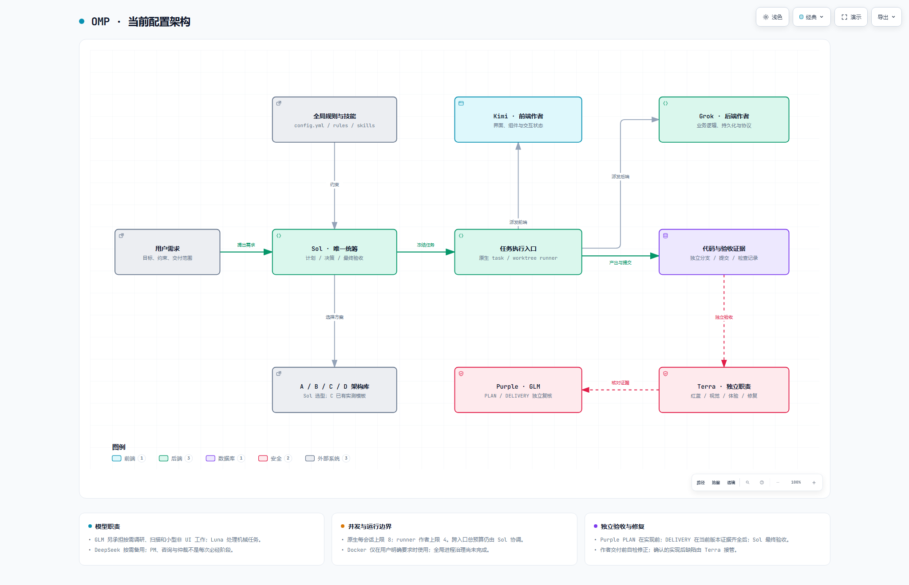
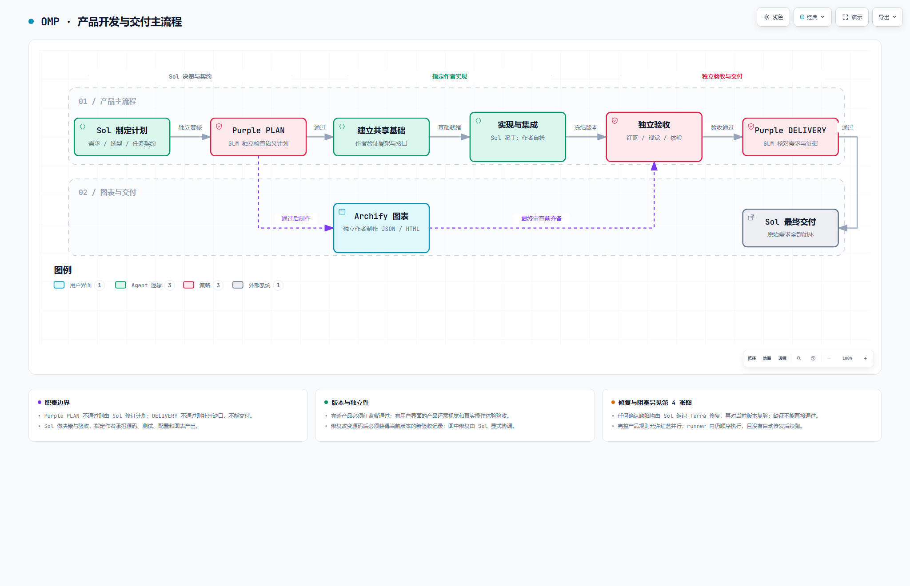
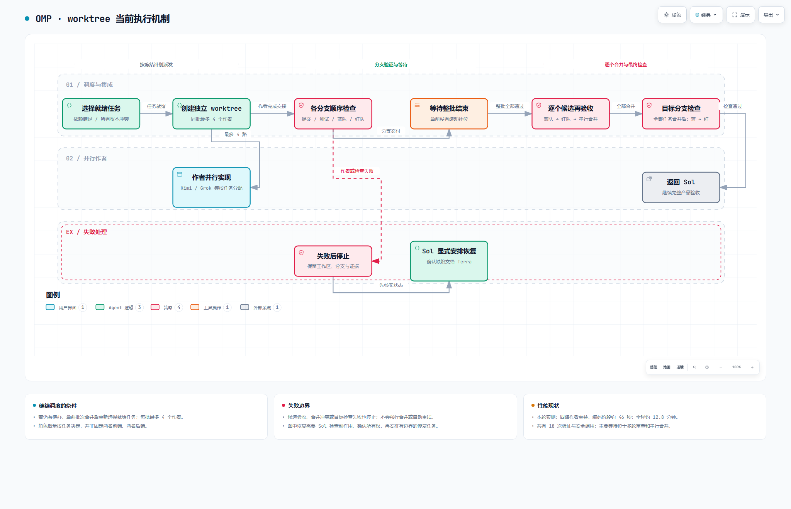
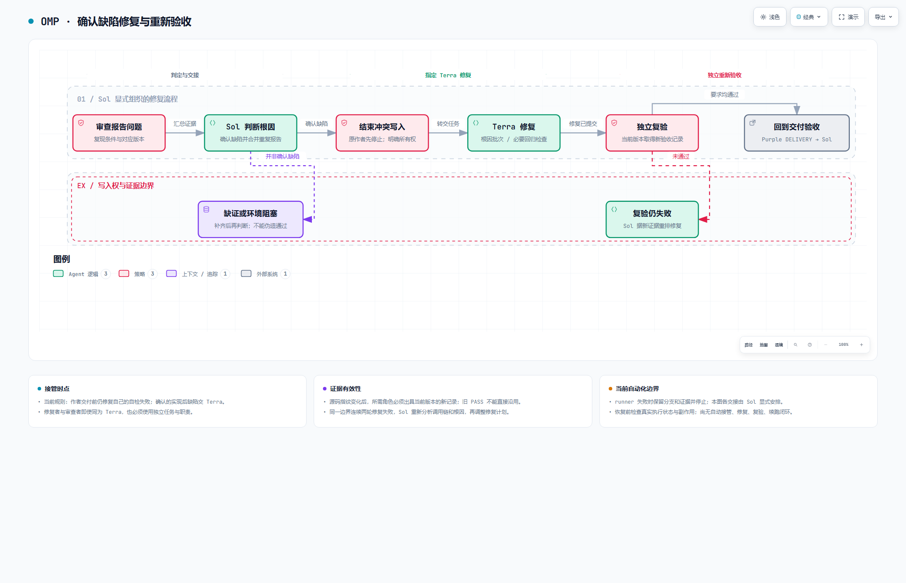

# OMP 配置架构与开发流程

本组图对应配置提交 [`18f18ab`](https://github.com/LJC-god/omp-config/commit/18f18abf8ca5043d9937e596f209ac08700d5541)，制作于 2026-09-20。它展示当时已配置的职责与 runner 实际行为；后续配置变化需要同步更新图，不能把图当作自动更新的运行状态。

## 查看方式

- **GitHub 上直接看图**：阅读下方 PNG 预览。
- **交互查看**：克隆或下载整个仓库后，用浏览器打开本目录的 [index.html](index.html)，进入四张独立 HTML 图。无需安装依赖、启动服务或使用 Docker。
- GitHub 仓库页面通常展示 HTML 源码，不直接执行交互图；只下载 index.html 会缺少链接文件，请保留整个目录。
- 每张图保留同名 JSON，可使用 Archify 重新生成。HTML 中包含主题、缩放、搜索和导出控件。

## 四张图

| 图 | 内容 | 交互 HTML | 可编辑源文件 |
| --- | --- | --- | --- |
| 01 配置架构 | Sol 统筹、模型分工、架构选择与全局约束 | [打开](01-omp-architecture.html) | [JSON](01-omp-architecture.json) |
| 02 开发主流程 | 需求、计划审查、并行实现和产品验收 | [打开](02-product-main.html) | [JSON](02-product-main.json) |
| 03 worktree runner | 四作者批次、候选验收、合并和失败停止 | [打开](03-worktree-runner.html) | [JSON](03-worktree-runner.json) |
| 04 修复流程 | Terra 修复确认缺陷，独立复验并更新交付证据 | [打开](04-repair-workflow.html) | [JSON](04-repair-workflow.json) |

### 01 · 配置架构



### 02 · 产品开发与交付主流程



### 03 · worktree 当前执行机制



### 04 · 确认缺陷修复与重新验收



## 关键口径

- Sol 负责规划、拆解、裁决和最终验收；作者按任务产出代码、测试和文档。
- 原生任务每会话上限 **8**，worktree runner 作者上限 **4**；总量规则不是机器级全局信号量。
- runner 按固定批次等待作者完成，再逐个候选执行 **Blue → Red → 合并**，之后进入下一批。产品流程允许安排并行审查，不代表 runner 已具备持续补位或并行门禁。
- Purple 的 PLAN / DELIVERY 使用 GLM 5.3；Terra 的修复、验证、安全、视觉和体验职责分开执行。
- 作者先完成交付前自检；确认的实现后缺陷交给 Terra，相关作者的写入租约结束后才开始修复。runner 失败会停止并保留证据，目前不会自动修复并续跑。
- Docker 仅在用户明确要求时使用；未接入 Reef，也未新增永久架构 agent。

## 配置依据

- [模型与任务配置](../../omp/agent/config.yml)
- [主 agent 编排规则](../../omp/agent/rules/main-agent-orchestrator.md)
- [验收证据规则](../../omp/agent/notes/verification-evidence.md)
- [架构选型目录](../../omp/agent/notes/architecture-catalog.md)
- [worktree runner 实现](../../scripts/task-plan-automation.ts)

## 验证与追溯

[delivery-manifest.json](delivery-manifest.json) 记录四张图的 JSON/HTML SHA-256、交付回执、浏览器回执及实际截图审阅。

- 四张图均通过 **9/9** 确定性检查，0 错误、0 警告，showcase 布局检查通过。
- 原始浏览器检查覆盖 1440×900、1600×1000、1920×1080、2048×1320，均通过；保留两种尺寸的明暗截图。
- 已检查每张图的实际明暗画面。自动回执及预览页中的 `visualReview: pending` 保留原样，单独的截图审阅结果位于 manifest 的 `perceptualReview`。
- HTML、JSON、原始回执和截图按原字节归档；回执内的绝对路径是生成机器的历史记录，不是本仓库的运行依赖。失败草稿及临时安装文件留在原实验目录，没有收录；manifest 中提及的废弃大图也不属于交付物。
- 本次入库验证文件哈希与本地链接；原有渲染检查沿用相同字节的证据，没有宣称重新完成产品安全验收，也没有完整测试所有交互或导出功能。

在仓库根目录运行归档检查：

```powershell
python scripts/verify_architecture_docs.py
```

## 更新方式与许可

生成器：[Archify](https://github.com/tt-a1i/archify)，固定版本提交 `72c750bb070d95171dbb2244e5b62b1b7da69c12`。随 HTML 分发的生成器代码许可见 [ARCHIFY-LICENSE.txt](ARCHIFY-LICENSE.txt)。查看图不需要安装 Archify。

更新时先核对配置和 runner，再在 `D:/Labs/omp/` 下新建实验目录修改 JSON。使用已安装 Archify 的 `validate`、`deliver` 和 `visual-check` 命令，实际查看截图后，再将最终产物及新的哈希和回执一起同步进本目录。修改源文件后不能沿用旧的验收回执。
